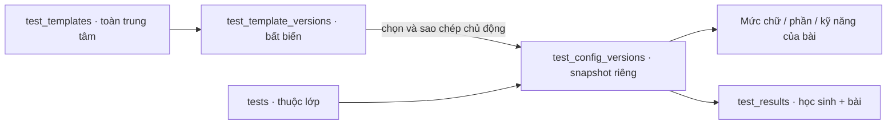

# Thiết kế database học vụ: template bài kiểm tra và snapshot

Ngày thiết kế: **31/10/2026**. Phạm vi: **thiết kế ERD/schema**. Các bảng bên dưới là **đề xuất cho GĐ5**, trừ phần [thư viện template](#thư-viện-template) (`20261031100000_test_templates.sql`, [biên bản](decisions/gd5-test-templates.md)) [bài kiểm tra/snapshot](#bài-kiểm-tra-và-snapshot-quan-hệ) (`20261031110000_tests.sql`, [biên bản](decisions/gd5-tests.md)) và `test_results`/`component_results` (`20261031120000_test_results.sql`, [biên bản](decisions/gd5-test-results.md)) đã triển khai local cùng ngày; `ielts_skill_results`/`ielts_criterion_results` (`20261031140000_ielts_results.sql`), công bố, nhận xét và xóa bài ([biên bản](decisions/gd5-publication-ielts-comments.md)) cũng đã triển khai local; khi khác biệt, migration là nguồn đúng. [Schema hiện hành](schema.md) và SQL trong `supabase/migrations/` tiếp tục mô tả phần đã triển khai.

Nguồn nghiệp vụ: [plans.md, C.8](plans.md#c8-bài-kiểm-tra-thang-điểm-và-điểm-thành-phần), TEST-01–06; ACAD-01, AUD-01 và XLS-06 cho các ranh giới liên quan. Nền tảng theo [techstack.md, 4.6](techstack.md#46-template-bài-kiểm-tra-và-ielts). ERD chỉnh sửa được: [architecture.drawio](../diagrams/architecture.drawio), các trang **03, 03a, 03b**.

## Phương án và ranh giới

Thiết kế cũ gồm `letter_templates` gắn lớp và bộ mức chữ riêng không còn phù hợp quyết định TEST-02 ngày 28/10/2026. Thay bằng **template đánh giá chung toàn trung tâm**, chứa số/phân số/chữ/IELTS; không có `class_id`, `site_id`, tenant hoặc quyền sở hữu theo lớp trên template.

Hai cách lưu cấu hình đã được cân nhắc:

| Cách lưu | Đánh đổi |
| --- | --- |
| Chuẩn hóa toàn bộ template và bài thành hai bộ bảng mức/phần/kỹ năng | FK chi tiết rõ nhưng lặp hai họ bảng và các quy tắc cấu hình; template không có kết quả cần liên kết tới từng phần |
| JSONB có kiểu cho phiên bản template; snapshot bài và kết quả dùng bảng quan hệ | Template lưu một cấu hình bất biến; khi dùng phải validate và sao chép sang các bảng của bài trong một RPC. FK ghép bảo vệ các kết quả theo cấu hình bài |

**Đề xuất chọn cách thứ hai.** Đây là lựa chọn thiết kế kỹ thuật của đợt này, không phải thay đổi đặc tả hoặc một triển khai đã được nghiệm thu. JSONB chỉ chứa dữ liệu theo schema phân biệt loại; không nhận SQL, JavaScript, biểu thức hoặc công thức tùy ý. Các phần của snapshot quan hệ là nguồn cấu hình của bài; không lưu thêm một JSON snapshot độc lập rồi duy trì hai nguồn sự thật.

Template không chứa ngày bài, danh sách học sinh, kết quả, nhận xét, trạng thái công bố hoặc câu hỏi/đáp án. Không thiết kế ngân hàng đề thi, file mẫu Excel hay mẫu DOCX trong các bảng này. Không triển khai module nhận xét, phụ huynh hoặc import trong phạm vi lần này.

## Quan hệ và vòng đời



- Tạo bài từ đầu: `source_template_version_id = NULL`. Chọn mẫu: lưu chính xác ID phiên bản nguồn rồi sao chép toàn bộ cấu hình; cho sửa bản sao theo quyền học vụ. ID nguồn chỉ là provenance, không bắt snapshot phải tiếp tục bằng template.
- Sửa template: thêm phiên bản bất biến và đổi con trỏ hiện hành của template; không cập nhật bài đã dùng, kể cả bài chưa có điểm. Xóa mềm ngừng lựa chọn; khôi phục dùng lại ID và các phiên bản cũ. Không xóa vật lý phiên bản hoặc đặt nguồn thành NULL khi lưu trữ mẫu.
- Cấu hình bài chốt khi tạo (TEST-03): mỗi bài đúng một snapshot (`revision = 1`), không chọn lại mẫu hay thay cấu trúc sau đó; không liên kết bài với “phiên bản mới nhất” của template. Chỉnh bản sao khi tạo bài không ghi ngược template.
- Mẫu chữ mặc định chứa Chưa đạt, Đạt, Tốt, Xuất sắc trong chính template chữ. Khi triển khai cần khởi tạo bằng thao tác hệ thống có provenance/lịch sử; không mở một thư viện mức chữ độc lập theo lớp.

## Quy ước cột

Tên dưới đây là tên SQL **dự kiến**, không phải xác nhận bảng đã tồn tại. `?` nghĩa là nullable; các cột khác NOT NULL. UUID dùng `gen_random_uuid()` khi cấp định danh. Không đặt unique cho tên template hoặc tên bài khi đặc tả không yêu cầu; dùng ID/phiên bản để đối chiếu.

- Các gốc có thể sửa (`test_templates`, `tests`, `test_results`) có `row_version bigint > 0`, `created_at timestamptz`, `created_by uuid`, `updated_at timestamptz`; actor tham chiếu `app.account_profiles(id)`. RPC kiểm tra `expectedVersion` sau khi lấy khóa.
- Xóa mềm dùng `deleted_at timestamptz?`, `deleted_by uuid?`, `deleted_reason text?`; ba giá trị phải đồng bộ. Phiên bản cấu hình và các bảng con không có CRUD/xóa mềm độc lập.
- Cấu hình bất biến có `created_at timestamptz`, `created_by uuid`; `revision bigint > 0` tăng trong phạm vi gốc. Không có `updated_at` vì không sửa phiên bản tại chỗ.
- Điểm số/max score dùng `numeric` **không typmod**, CHECK không âm hoặc dương theo trường và `scale(value) <= 2`; không dùng ép `numeric(...,2)` làm bước validate vì có thể làm tròn đầu vào. API/RPC phải từ chối độ chính xác sai trước các phép tính/ghi. Không tự thêm giới hạn điểm tối đa chưa được đặc tả chốt.
- Band dùng `numeric`, CHECK `0 <= value AND value <= 9 AND value * 2 = trunc(value * 2)`. Không cắt trung bình IELTS về hai số lẻ. Câu đúng/tổng số câu dùng integer với kiểm tra miền; thứ tự dùng smallint.
- `ON DELETE RESTRICT`/`NO ACTION` cho lịch sử và nguồn; không cascade xóa dữ liệu nghiệp vụ. RLS bật; không grant trực tiếp bảng `app` cho `anon`/`authenticated`. Mutations qua `api` RPC, `SECURITY DEFINER` có `search_path` an toàn và grant hẹp.

## Thư viện template

### app.test_templates

| Cột | Kiểu | Ý nghĩa/ràng buộc |
| --- | --- | --- |
| `id` | uuid PK | Định danh ổn định xuyên các phiên bản/xóa mềm/khôi phục |
| `current_version_id` | uuid | FK ghép `(id, current_version_id)` → `test_template_versions(template_id, id)`, trì hoãn đến commit |
| Cột gốc và xóa mềm | Theo quy ước | Chỉ Admin thay đổi; không có FK lớp/cơ sở |

### app.test_template_versions

| Cột | Kiểu | Ý nghĩa/ràng buộc |
| --- | --- | --- |
| `id` | uuid PK | Phiên bản nguồn được bài tham chiếu |
| `template_id` | uuid FK | → `test_templates(id)` |
| `revision` | bigint | UQ `(template_id, revision)`; UQ `(template_id, id)` phục vụ FK con trỏ |
| `name` | text | Tên không rỗng; lưu theo phiên bản để giữ lịch sử tên |
| `description` | text? | Mô tả mẫu; không phải mô tả/ngày của bài thực tế |
| `config_schema_version` | smallint | Phiên bản cấu trúc JSON được backend hỗ trợ; không do client tự khai phiên bản tương lai |
| `config` | jsonb | Cấu hình được validate và chuẩn hóa đầy đủ như bên dưới |
| `created_at`, `created_by` | timestamptz, uuid FK | Thời điểm và actor tạo phiên bản; bất biến |

Không có `letter_template_levels`: mức chữ của template nằm trong `config.levels`. JSONB được validate tại DB/RPC, không chỉ bằng TypeScript. Cần cơ chế ngăn UPDATE/DELETE phiên bản và ngăn thay bảng con cấu hình đã chốt; quyền owner vận hành không được dùng để bỏ qua luồng nghiệp vụ thường ngày.

### Schema dữ liệu của config

Các thuộc tính không thuộc nhánh tương ứng bị từ chối. `showComponents` là giá trị khởi tạo tùy chọn hiển thị; chỉ có ý nghĩa với bài theo phần hoặc IELTS có chi tiết. `formulaVersion` do backend gắn cố định cho IELTS, client/template không chọn công thức.

| `scaleKind` | Thuộc tính cấu hình bắt buộc | Kiểm tra |
| --- | --- | --- |
| `numeric` | `inputMode: direct`, `maxScore`; hoặc `inputMode: components`, `maxScore`, `components[]` | Tối đa dương, ≤2 số lẻ; theo phần có 1–50 phần, tổng tối đa đúng tổng các phần |
| `fraction` | `inputMode: direct`, `totalQuestions`; hoặc `inputMode: components`, `totalQuestions`, `components[]` | Tổng câu nguyên dương; theo phần có 1–50 phần và tổng câu bằng tổng từng phần |
| `letter` | `inputMode: direct`, `levels[]` | 1–20 mức, nhãn 1–100 ký tự, duy nhất theo chuẩn hóa tên, có thứ tự |
| `ielts` | `skills[]`, `formulaVersion` | 1–4 kỹ năng khác nhau thuộc L/R/W/S, mỗi kỹ năng có chế độ riêng `direct` hoặc `detailed` |

Phần chứa mã trong phiên bản, tên 1–200 ký tự, thứ tự và `maxScore` hoặc `totalQuestions` đúng loại; tên duy nhất sau chuẩn hóa. Mức chữ có mã ổn định trong phiên bản, nhãn và thứ tự. Mã chỉ định danh cấu hình, không dùng tên làm khóa Excel. Bản sao bài cấp ID riêng cho mức/phần và giữ thứ tự, nhãn, giới hạn của snapshot.

IELTS L/R chi tiết có `maxQuestions` nguyên dương; trực tiếp không có số câu. W/S chi tiết dùng bộ tiêu chí cố định dưới đây, không có số câu hoặc trọng số tùy biến. Các mã tiêu chí và thứ tự Task được xác định bởi `formulaVersion`; snapshot bài giữ phiên bản đó, không tra cấu hình template hiện hành. Bộ xử lý công thức theo phiên bản phải được giữ để đọc lại lịch sử.

Ví dụ JSON của phiên bản template IELTS (dữ liệu minh họa):

```json
{
  "scaleKind": "ielts",
  "showComponents": true,
  "formulaVersion": "mledu-ielts-v1",
  "skills": [
    { "code": "L", "inputMode": "detailed", "maxQuestions": 40 },
    { "code": "R", "inputMode": "direct" },
    { "code": "W", "inputMode": "detailed" },
    { "code": "S", "inputMode": "direct" }
  ]
}
```

`mledu-ielts-v1` là tên phiên bản kỹ thuật đề xuất cho đúng công thức TEST-01 đã chốt; không tuyên bố đã triển khai hoặc là toàn bộ quy trình IELTS chính thức. Một template chỉ có L/R cũng hợp lệ; không bắt đủ bốn kỹ năng.

## Bài kiểm tra và snapshot quan hệ

### app.tests

| Cột | Kiểu | Ý nghĩa/ràng buộc |
| --- | --- | --- |
| `id` | uuid PK | Cho trùng tên, không trùng định danh |
| `class_id` | uuid FK | → `classes(id)`; không làm template thành tài sản của lớp |
| `name` | text | Bắt buộc |
| `test_on` | date | Ngày nghiệp vụ; kiểm tra hiệu lực lớp và hợp khoảng tham gia theo TEST-05 |
| `description` | text? | Cho để trống |
| `current_config_id` | uuid | FK ghép `(id, current_config_id)` → `test_config_versions(test_id, id)`, trì hoãn đến commit |
| `show_components` | boolean | Một tùy chọn toàn bài, bao gồm chi tiết IELTS; khởi tạo từ template/cấu hình riêng |
| Cột gốc và xóa mềm | Theo quy ước | Đổi hiển thị độc lập với đổi cấu trúc chấm điểm |

`show_components` nằm trên bài, không nằm trong cấu hình chấm bất biến: TEST-04 cho phép Admin/giáo viên đổi khi đang công bố mà không nhập lại điểm. Trợ giảng không đổi tùy chọn này. Mỗi lần đổi vẫn có phiên bản nghiệp vụ và audit; không thay trạng thái công bố điểm/nhận xét. Đổi cấu trúc/chọn lại mẫu không ngầm thay tùy chọn hiện hành; nếu yêu cầu đổi cả hai thì kiểm tra riêng quyền đổi hiển thị trong cùng lệnh.

### app.test_config_versions

| Cột | Kiểu | Ý nghĩa/ràng buộc |
| --- | --- | --- |
| `id` | uuid PK | ID snapshot dùng cho kết quả và `_Meta` Excel |
| `test_id` | uuid FK | → `tests(id)`; UQ `(test_id, revision)` và `(test_id, id)` |
| `revision` | bigint | Tăng theo bài; không bằng phiên bản template một cách mặc định |
| `scale_kind` | text | `numeric / fraction / letter / ielts` |
| `input_mode` | text? | `direct / components` cho số/phân số; `direct` cho chữ; NULL với IELTS vì mode thuộc từng kỹ năng |
| `max_score` | numeric? | Chỉ thang số; theo phần bằng tổng tối đa của các phần |
| `total_questions` | integer? | Chỉ phân số; theo phần bằng tổng câu toàn bài |
| `formula_version` | text? | Chỉ IELTS; backend gắn phiên bản công thức đã phê duyệt |
| `source_template_version_id` | uuid? FK | → `test_template_versions(id)`; NULL nếu tạo riêng; không trigger cập nhật dây chuyền |
| `created_at`, `created_by` | timestamptz, uuid FK | Thời điểm và actor tạo snapshot |

### app.test_letter_levels

`id uuid PK`, `config_id uuid FK → test_config_versions(id)`, `label text`, `label_key text`, `sort_order smallint`.

UQ `(config_id, id)`, `(config_id, label_key)` và `(config_id, sort_order)`. Chỉ cấu hình chữ có mức; 1–20 mức, nhãn 1–100 ký tự. `label_key` dùng chuẩn hóa tên thống nhất với dự án. Không đọc mức từ template để hiển thị kết quả cũ.

### app.test_components

`id uuid PK`, `config_id uuid FK → test_config_versions(id)`, `name text`, `name_key text`, `max_score numeric?`, `total_questions integer?`, `sort_order smallint`.

UQ `(config_id, id)`, `(config_id, name_key)` và `(config_id, sort_order)`. Chỉ số/phân số theo phần có 1–50 dòng; đúng một loại giới hạn theo thang; tổng khớp cấu hình cha. Direct/chữ/IELTS không có phần ở bảng này. Số lượng/tổng và loại của bảng con cần deferred constraint trigger hoặc validator giao dịch; CHECK một dòng không chứng minh được chúng.

### app.test_ielts_skills

`config_id uuid FK → test_config_versions(id)`, `skill text`, `input_mode text`, `max_questions integer?`; PK `(config_id, skill)`.

Chỉ cấu hình IELTS có 1–4 dòng với `skill IN ('L','R','W','S')`, `input_mode IN ('direct','detailed')`. `max_questions` bắt buộc và dương chỉ với L/R detailed, NULL cho các trường hợp khác. Không có mode theo học sinh hoặc trạng thái công bố theo kỹ năng. W/S không dùng `test_components` để cộng điểm theo luật số/phân số.

## Kết quả theo học sinh/bài và dữ liệu IELTS

### app.test_results

| Cột | Kiểu | Ý nghĩa/ràng buộc |
| --- | --- | --- |
| `id` | uuid PK | Giữ ID khi sửa, xóa/khôi phục |
| `student_id` | uuid FK | → `students(id)` |
| `test_id` | uuid FK | → `tests(id)`; UQ `(student_id, test_id)` kể cả xóa mềm; không FK hồ sơ lớp/lần tham gia |
| `config_id` | uuid | FK ghép `(test_id, config_id)` → `test_config_versions(test_id, id)`; UQ `(id, config_id)` |
| `result_kind` | text | `graded / absent`; Vắng không có điểm hoặc dòng điểm con |
| `numeric_score` | numeric? | Thang số: nhập trực tiếp hoặc tổng/tổng tạm do backend tính |
| `correct_answers` | integer? | Phân số: nhập trực tiếp hoặc tổng/tổng tạm; mẫu số lấy toàn cấu hình |
| `letter_level_id` | uuid? | FK ghép `(config_id, letter_level_id)` → `test_letter_levels(config_id, id)` |
| `overall_band` | numeric? | Chỉ IELTS đủ bốn band; backend tính, không nhận ghi đè |
| `published_at`, `published_by` | timestamptz?, uuid? FK | Cùng NULL hoặc cùng có giá trị; actor → `account_profiles(id)` |
| Cột gốc và xóa mềm | Theo quy ước | Phiên bản lịch sử gồm cả kết quả và các dòng con |

Không có dòng kết quả hoặc chưa có đầu vào khác Vắng/điểm 0. Trạng thái hoàn tất là giá trị suy ra từ cấu hình và đầu vào, không phải cờ do client quyết định. Current result phải dùng `tests.current_config_id`; FK chỉ bảo đảm cùng bài, nên RPC/trigger cần bảo đảm thêm cấu hình hiện hành. Chỉ cho công bố khi hoàn tất hoặc Vắng.

Công bố cả lớp chỉ áp dụng cho các kết quả hoàn tất/Vắng trong bài đã chọn và trả danh sách học sinh chưa có kết quả hoặc còn thiếu dữ liệu. Không từ chối toàn bộ lệnh chỉ vì có học sinh chưa hoàn tất; mọi cập nhật được chọn vẫn thuộc một transaction với audit/outbox theo yêu cầu. Nhập bổ sung cho học sinh bị bỏ qua không tự công bố; người có quyền phải chủ động công bố lại phạm vi đó theo ACAD-01.

### app.component_results

`result_id uuid`, `config_id uuid`, `component_id uuid`, `numeric_value numeric?`, `correct_answers integer?`; PK `(result_id, component_id)`.

FK `(result_id, config_id)` → `test_results(id, config_id)` và `(config_id, component_id)` → `test_components(config_id, id)` chặn nhập nhầm bài/phiên bản. Mỗi dòng có đúng một giá trị đúng loại và trong giới hạn của phần; thiếu dòng là chưa nhập, giá trị 0 là đã nhập. Backend tính tổng tạm từ dòng đã nhập, không công bố thiếu phần; phân số luôn dùng tổng câu toàn bài, không rút gọn hoặc thu nhỏ mẫu số.

### app.ielts_skill_results

`result_id uuid`, `config_id uuid`, `skill text`, `correct_answers integer?`, `input_band numeric?`, `calculated_band numeric?`, `task1_band numeric?`, `task2_band numeric?`.

PK `(result_id, skill)`; UQ `(result_id, config_id, skill)`. FK `(result_id, config_id)` → `test_results(id, config_id)` và `(config_id, skill)` → `test_ielts_skills(config_id, skill)`.

- L/R detailed: câu đúng và band nhập tay là hai đầu vào độc lập, có thể lưu thiếu một; hoàn tất cần cả hai. Không tự quy đổi. L/R direct: chỉ `input_band`, không có câu đúng.
- W/S direct: chỉ `input_band`. W/S detailed: không nhận `input_band`; `calculated_band` và các band Task là cache do backend tính từ tiêu chí. `task1_band`/`task2_band` chỉ có cho W detailed; thiếu đầu vào cần thiết thì cache tương ứng NULL.
- Band kỹ năng hiệu lực lấy `input_band` hoặc `calculated_band` theo mode; không giữ đồng thời cả hai. Không điền 0 cho thiếu dữ liệu. Đổi điểm con phải khóa cùng dòng kết quả cha và kiểm tra công bố.

### app.ielts_criterion_results

`result_id uuid`, `config_id uuid`, `skill text`, `criterion_code text`, `band numeric`; PK `(result_id, skill, criterion_code)`.

FK `(result_id, config_id, skill)` → `ielts_skill_results(result_id, config_id, skill)`. Chỉ W/S detailed được có tiêu chí. Thiếu dòng nghĩa là chưa nhập, không phải band 0. Validator dùng `formula_version` của snapshot để kiểm tra đúng bộ mã cố định:

| Kỹ năng/Task | Mã tiêu chí | Trọng số |
| --- | --- | --- |
| W Task 1 | `t1_ta`, `t1_cc`, `t1_lr`, `t1_gra` | Bằng nhau; TA = Task Achievement |
| W Task 2 | `t2_tr`, `t2_cc`, `t2_lr`, `t2_gra` | Bằng nhau; TR = Task Response |
| S | `fc`, `lr`, `gra`, `pronunciation` | Bằng nhau; FC = Fluency and Coherence |

CC = Coherence and Cohesion; LR = Lexical Resource; GRA = Grammatical Range and Accuracy. Template không được đổi tiêu chí/trọng số hoặc lưu mã ngoài bộ này. Không cần bảng Task có quyền cấu hình riêng.

### Công thức cố định theo TEST-01

`roundBand(x) = floor(2*x + 0.5)/2` với số chính xác không âm. Làm tròn từng Task trước, rồi `Writing = roundBand((Task1 + 2*Task2)/3)`. Speaking là roundBand trung bình bốn tiêu chí. Overall là roundBand trung bình L/R/W/S, chỉ khi chọn đủ bốn và đủ bốn band. Bài có 1–3 kỹ năng đủ đầu vào vẫn hoàn tất/công bố được và Overall là NULL.

Các giá trị `numeric_score` theo phần, tổng câu đúng theo phần, band Task/W/S detailed và Overall đều do backend tính lại; client/Excel không ghi đè. Không công bố độc lập kỹ năng/Task/tiêu chí. Khi `show_components = false`, API phụ huynh chỉ trả các band kỹ năng và Overall đã công bố; không trả câu đúng, Task hoặc tiêu chí. Bài chưa công bố/Vắng dùng quy tắc riêng trong TEST-01, không tạo band giả.

## Giao dịch, quyền và lịch sử cần triển khai

| Lệnh dự kiến | Quyền và thứ tự cần bảo đảm |
| --- | --- |
| Tạo/sửa template | Chỉ Admin hiện hành; khóa gốc, kiểm tra expectedVersion, validate, thêm phiên bản, đổi con trỏ, ghi lịch sử và một audit trong cùng transaction |
| Xóa mềm/khôi phục template | Chỉ Admin; kiểm tra phiên bản, lý do khi xóa; giữ mọi phiên bản và provenance của bài cũ; lịch sử/audit nguyên khối |
| Đọc/chọn template | Admin hoặc User có phân công giáo viên/trợ giảng đang hiệu lực và quyền học vụ trong lớp đích; không mở quyền cho Receptionist hoặc User chưa có scope. Chỉ chọn mẫu chưa xóa; đọc lịch sử theo quyền phù hợp |
| Tạo bài hoặc chọn lại mẫu | Khóa template khi chọn, kiểm tra lại chưa xóa và đúng phiên bản đã preview; khóa bài theo thứ tự thống nhất. Sao chép và chỉnh riêng, tạo đầy đủ cấu hình con rồi đổi con trỏ trong một transaction. Tạo không dùng template không phụ thuộc thư viện |
| Đổi cấu trúc có kết quả | Admin/giáo viên/trợ giảng đúng lớp; chặn nếu bất kỳ điểm nào còn công bố. Snapshot lịch sử kết quả và mọi dòng con, tạo config mới, xóa đầu vào hiện hành cũ sau lưu lịch sử, chuyển result sang config mới, giữ Vắng và xóa cache điểm; các kết quả có điểm phải nhập lại. Không đổi nhận xét/công bố nhận xét |
| Nhập/sửa kết quả | Admin hoặc giáo viên/trợ giảng đúng lớp; khóa bài và kết quả, kiểm tra cấu hình hiện hành, phạm vi thời gian tham gia và chưa công bố; tính lại bằng DB/RPC; ghi phiên bản đầy đủ và audit nguyên khối |
| Công bố/hiện chi tiết/xóa hoặc khôi phục cả bài | Chỉ Admin hoặc giáo viên hiệu lực; trợ giảng/Receptionist bị chặn. Công bố cả lớp chỉ lấy kết quả hoàn tất/Vắng, bỏ qua và trả danh sách thiếu; nhập bổ sung không tự công bố. Xóa bài tự hủy công bố điểm và nhận xét gắn bài theo TEST-06, nguyên khối; khôi phục dùng ID cũ, tất cả về chưa công bố |

FK vòng của template/phiên bản và bài/config cần `DEFERRABLE INITIALLY DEFERRED`; dùng ID đã cấp trước, tạo gốc và phiên bản trong cùng transaction. Các FK còn lại không mặc định trì hoãn. Thứ tự khóa thống nhất giữa chọn mẫu/xóa mẫu, cấu hình/nhập điểm/công bố/xóa bài; kiểm tra lại phiên, quyền và phiên bản sau chờ khóa để tránh TOCTOU. Không coi workspace hoặc JWT cũ là đủ quyền.

`business_entity_versions` hiện có sẽ lưu snapshot aggregate trước/sau gồm tất cả đầu vào, dòng con, cache, cấu hình nguồn và trạng thái công bố bị thay thế. Cấu hình và phiên bản template bất biến giữ không thời hạn; dữ liệu con cũ chỉ được bỏ khỏi bảng **hiện hành** khi bản lịch sử đầy đủ đã được ghi trong cùng transaction. Audit 60 ngày không phải nguồn duy nhất giữ điểm cũ. Yêu cầu thông báo bắt buộc, nếu có theo nghiệp vụ công bố, được ghi outbox cùng transaction; không thêm thông báo chỉ vì thiết kế có bảng outbox.

Excel tương lai dùng ID bài + `config_id`/revision và mã phần/kỹ năng/tiêu chí của snapshot trong `_Meta`; backend từ chối cấu hình cũ, không lấy template mới để đọc file cũ. Nhập chỉ gửi đầu vào, cả file một RPC/audit; không tạo bài/template qua Excel.

## Đối chiếu và bước triển khai tiếp theo

| Yêu cầu | Phần thiết kế đáp ứng | Bằng chứng cần có khi triển khai |
| --- | --- | --- |
| TEST-02 | Template toàn trung tâm, Admin-only, version bất biến, mức chữ trong JSON, xóa mềm | Hai lớp dùng cùng mẫu; sửa/xóa/khôi phục không thay bài cũ; User/Receptionist bị chặn ghi; audit lỗi rollback |
| TEST-01, TEST-04 | Bốn loại cấu hình, input mode, phần/mức/kỹ năng và đầu vào có kiểu | Biên thập phân/band/câu đúng; 1/20 mức, 1/50 phần; thiếu khác 0; IELTS Task 1:2, biên 0,25/0,75 và không quy đổi L/R |
| TEST-03 | Config chốt khi tạo bài, một snapshot mỗi bài, provenance tùy chọn | Không có lệnh đổi cấu hình; DB từ chối snapshot thứ hai |
| TEST-05–06, ACAD-01 | Khóa học sinh/bài, ngày theo khoảng tham gia, công bố cấp kết quả, hiển thị độc lập, xóa/khôi phục | Thêm lại hồ sơ không nhân đôi điểm; ngày mới không loại học sinh đã có kết quả/nhận xét; quyền công bố; công bố cả lớp bỏ qua/trả danh sách thiếu và không tự công bố sau nhập bổ sung; khôi phục chưa công bố |
| AUD-01, XLS-06 | History/outbox trong transaction; config ID cho Excel | Rollback khi history/audit/outbox lỗi; import dùng schema bài, không dùng template hiện hành |

Chưa chạy kiểm thử DB cho thiết kế này vì chưa có migration. Không đóng checkbox GĐ5, CI hoặc hosted từ ERD/tài liệu. Bước thực hiện kế tiếp là **một feature thư viện template**: migration hai bảng template, validator bốn loại, RPC Admin-only và kiểm thử quyền/phiên bản/audit; sau đó mới triển khai bài và snapshot theo thứ tự GĐ5.
